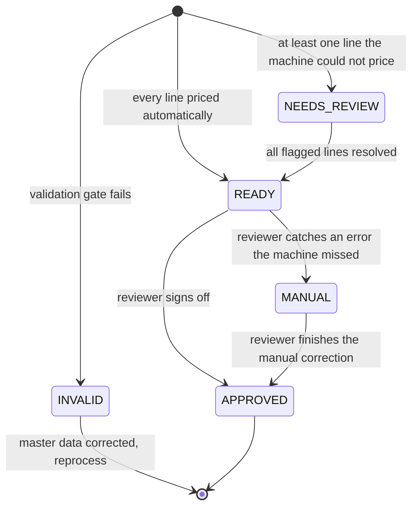
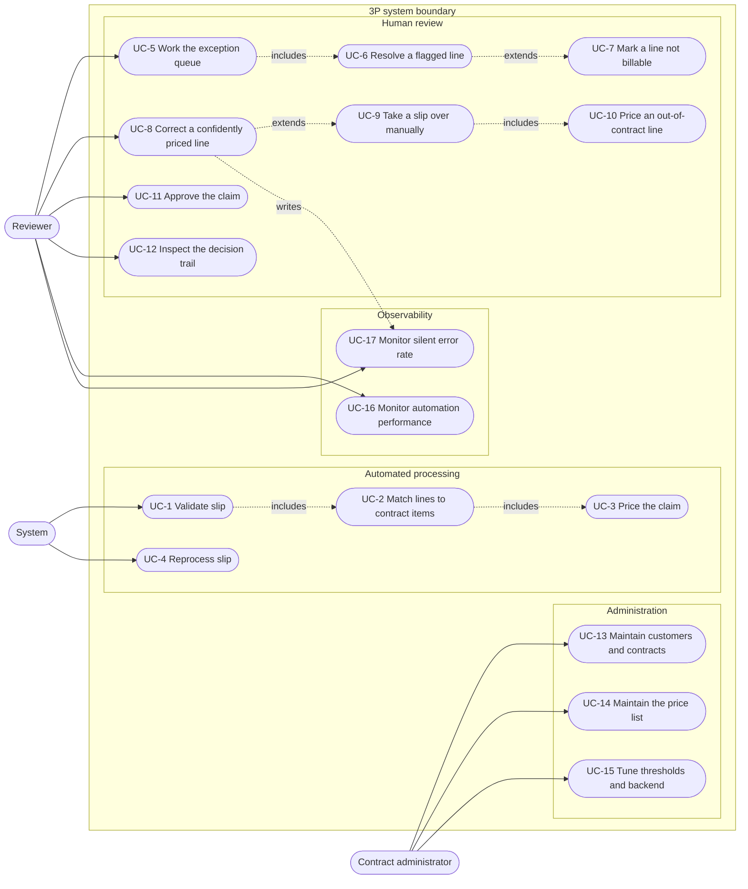
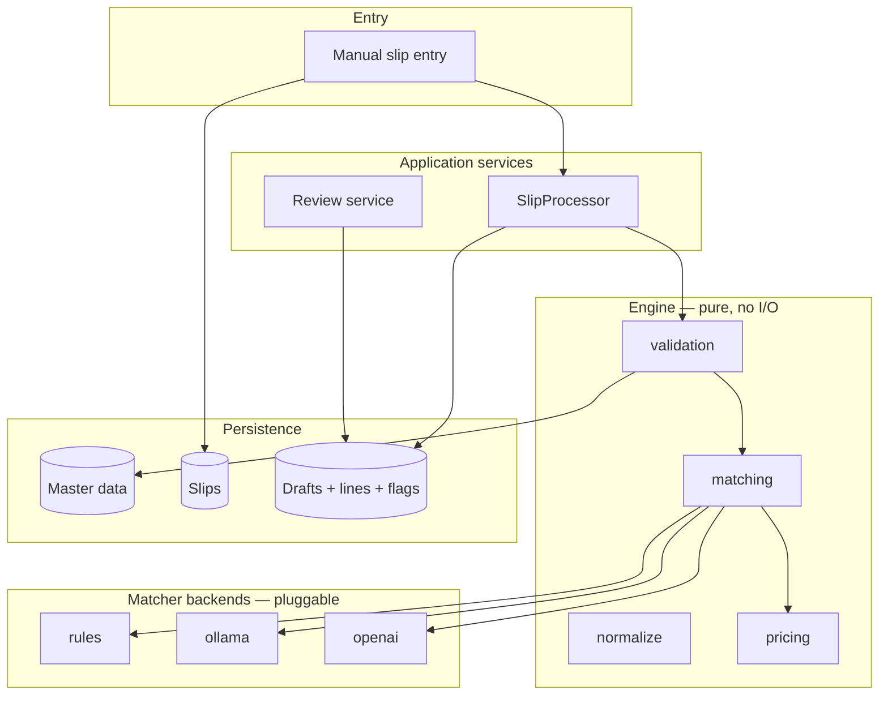
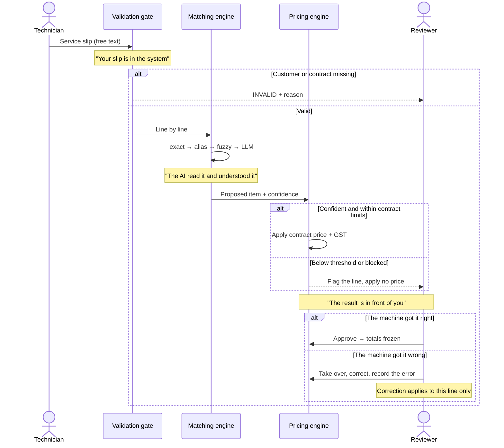
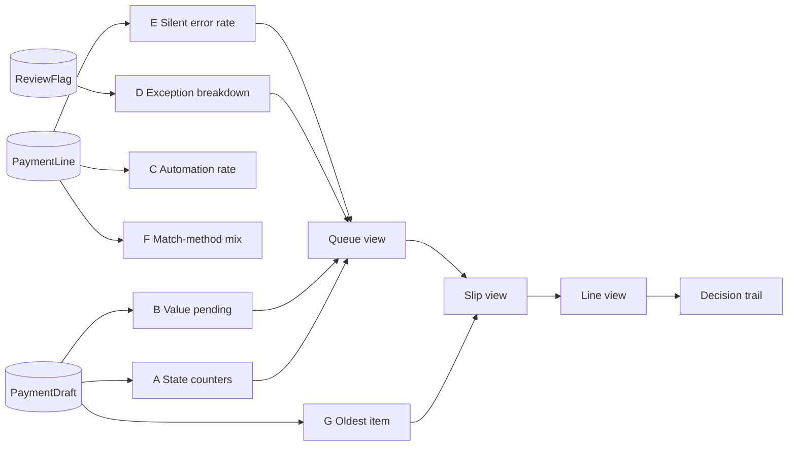

# 3P — Domain, Lifecycle and Information Architecture

This document defines *what the system does* before anything defines *how it
looks*. It is the contract the UI must serve, not the other way round.

It contains no visual design decisions.

## Scope

3P is a **demonstrator**, not a production deployment. That is a deliberate
boundary and it decides which problems are in scope:

- **Slip intake is out of scope.** Slips are prepared by hand. In a real
  deployment the intake path is designed around the customer's existing field
  process, so there is no general solution worth building here.
- **Downstream of approval is out of scope.** Invoicing, ERP posting, dispute
  handling and settlement belong to the customer's finance stack.
- **In scope** is the part that is the same everywhere and is the reason to buy
  the product: turning free-text field descriptions into a priced, defensible
  progress payment, and showing an expert exactly what the machine decided and
  why.

Everything below is written against that boundary.

---

## 1. Domain

A contractor performs field work for corporate customers under a **contract**
that fixes a price list for a period. A technician records what was done on a
**service slip** in free text. Before the contractor can claim money, every
line of that slip must be mapped onto a priced contract item. That mapping is
the progress payment (*hakediş*) process, and it is what this system automates.

The commercial guarantee of the product is narrow and deliberate:

> The AI proposes a mapping. The pricing engine applies the contract price.
> A model never writes a number.

Everything below exists to make that guarantee provable — including the parts
that let an expert prove the machine *wrong*.

### 1.1 Actors

| Actor | Type | Responsibility | Status |
|---|---|---|---|
| Technician | Human, field | Records the slip: what was done, quantities, units | Represented by hand-prepared slips — out of scope by design |
| Validation gate | System, deterministic | Decides whether a claim may exist at all | Built — `engine/validation.py` |
| Matching engine | System, AI-assisted | Proposes one contract item per slip line | Built — `engine/matching.py` |
| Pricing engine | System, deterministic | Applies contract price, quantity/unit rules, GST | Built — `engine/pricing.py` |
| Reviewer (hakediş specialist) | Human, back office | Resolves exceptions, corrects the machine, takes slips over manually, approves | Partially built |
| Contract administrator | Human, back office | Maintains customers, contracts, price lists | Not built |

The reviewer is the only actor the interface must actually serve. Every screen
exists to answer a question that reviewer has.

### 1.2 Core entities

Already modelled in `app/models.py`:

`Customer` → `Contract` → `ContractItem` → `ItemAlias`
`ServiceSlip` → `SlipLine`
`PaymentDraft` → `PaymentLine`, `ReviewFlag`

One slip produces exactly one draft (`slip_id` is unique on `PaymentDraft`).
One slip line produces exactly one payment line. A flag is attached either to
the draft (validation failure) or to a specific payment line (matching or
pricing failure).

The only entity the lifecycle below requires and the model lacks is a record of
**what the machine originally proposed**, kept after a human overrides it — see
§2.4.

---

## 2. Service slip lifecycle

### 2.1 State machine



Mapping to today's `DraftStatus`:

| State | Today | Change required |
|---|---|---|
| INVALID | `REJECTED` | Rename only. It is a machine refusal on master data, and calling it "rejected" invites confusion with a human decision |
| NEEDS_REVIEW | `REVIEW` | None |
| READY | `DRAFT` | Rename. The enum says `DRAFT`, the UI says "Ready for Payment", the sales conversation says something else again |
| MANUAL | — | **New.** See §2.3 |
| APPROVED | `APPROVED` | None |

### 2.2 Narrative per state

**INVALID.** The deterministic gate refused the claim: the customer code is
unknown, no contract was active on the service date, or the slip reports no
work. No prices are computed and no AI runs. This is a **master-data problem,
not a judgement call** — the fix is to register the customer or the contract
and reprocess. The slip persists with draft-level `ReviewFlag` rows explaining
the refusal.

**NEEDS_REVIEW.** At least one line hit a blocker: no counterpart in the price
list, confidence below threshold, unit mismatch, or a quantity above the
contractual ceiling. Lines that *did* match keep their price; blocked lines
carry `needs_review = True` and a flag. The machine is explicitly saying *I do
not know* — which is the behaviour that makes it trustworthy.

The draft total is currently forced to zero in this state. That is wrong: the
reviewer needs to see the value already secured and the value still at stake in
order to judge how urgent the slip is. Totals should be reported as
**confirmed** and **pending**, not suppressed.

**READY.** Every line was priced without human input. The claim is complete as
far as the machine can tell and is waiting for a signature. This is a sign-off
queue, not an exception queue.

READY does not mean *correct*. It means *the machine was confident*. The
difference between those two is the whole reason for the next state.

**MANUAL.** The reviewer has taken the slip out of the automated flow and will
finish it himself. Two triggers, both real:

1. The work on the slip has no counterpart in the price list at all — an
   out-of-contract situation the catalogue was never going to cover.
2. The machine priced the line confidently and got it wrong — it picked the
   wrong catalogue item, and the reviewer recognised it.

Trigger 2 is the important one. It can only be caught on a slip that is sitting
in READY looking perfectly healthy, so **every line has to be actionable
whether or not it is flagged** — the Streamlit build skipped any line where
`needs_review` was false, which made a silent mispricing uncorrectable through
the interface and the metric in §2.3 uncountable from live data.

**MANUAL is reachable only from READY.** A slip in NEEDS_REVIEW is already the
machine asking for help, and working it there is ordinary review, not a
take-over. Restricting the entry point keeps the silent-error metric in §2.3
clean: everything that lands in MANUAL is, by construction, a case the machine
got wrong while believing it was right.

MANUAL is a working state, not a terminal one. Inside it the reviewer may edit
any line, including typing a price for work the catalogue does not cover
(UC-10). The slip leaves the state by being approved.

**APPROVED.** A named reviewer accepted the claim. Totals are recomputed from
the line values at that instant and frozen. `resolved_at` and `resolved_by` are
stamped. Past this point the figures do not change.

### 2.3 What "reject" means here, and what it does not

A reviewer does not reject a *claim* — the work was done and it will be billed
one way or another. What a reviewer rejects is **the machine's handling of the
slip**. The action is *take this over*, and its meaning is operational routing,
not a commercial verdict.

This distinction has to survive into the data model, because the two produce
completely different reporting:

| | Trigger | Meaning | Metric it feeds |
|---|---|---|---|
| INVALID | Machine, before pricing | The claim cannot exist yet — master data is missing | Data quality |
| NEEDS_REVIEW | Machine, during pricing | The machine knows it does not know | Automation rate |
| MANUAL | Human, after pricing | The machine did not know that it did not know | **Silent error rate** |

The third row is the honest number. The README currently reports zero silent
mispricings, measured offline against `SlipLine.truth_item_code` in
`scripts/evaluate.py`. Making that same number observable *inside* the
application — by giving the reviewer the ability to catch one and record it —
turns a claim in a README into a demonstrable property of the system. It is the
single most persuasive thing this demo can do.

### 2.4 Corrections are local, not rules

The current build turns every correction into a permanent rule. `resolve_line`
defaults to `learn_alias=True`, writes an `ItemAlias` with `source="expert"`,
and from then on that exact phrasing matches at 0.99 confidence on every future
slip, for every future job, without a model being consulted.

**This is based on a false assumption about the domain.** The same field
phrasing does not reliably mean the same catalogue item. Two slips can carry
identical wording and legitimately resolve to different contract items
depending on what was actually done on site. Promoting a one-off judgement to a
standing rule means a single context-specific correction is silently applied to
unrelated future work — and because the alias layer sits *above* fuzzy matching
and the model, the wrong answer arrives with high confidence and no flag. It
would manufacture exactly the silent mispricing the product claims to prevent.

The corrected position: **an expert's decision applies to the line it was made
on and nothing else.**

Seed aliases shipped with a contract stay. They are a different kind of object:
catalogue synonyms authored alongside the price list, not generalisations
inferred from one incident. They also do real work — `SEED_ALIASES` contains
`"split system filter"` for FLT-001 and `"split system service"` for SVC-001,
two entries that exist precisely to keep a part from being confused with the
labour of fitting it. Removing the alias layer would delete the only exact
mechanism the pipeline has for that distinction. See §2.5.

What survives is the *decision record*: when a reviewer overrides the machine,
the original proposal must be kept alongside the correction rather than
overwritten. Today `resolve_line` overwrites `match_method`, `confidence` and
`rationale` in place, so the fact that the engine proposed something different
is destroyed at the moment it becomes interesting. Keeping it costs three
columns and is what makes §2.3's silent-error metric computable at all.

### 2.5 Material and labour must never be confused

Every contract item is either a **material** (a thing supplied) or **labour**
(work performed) — `ItemCategory` already carries this. Confusing the two is
the most expensive error the system can make, and it is also the one fuzzy text
matching is most prone to, because a part and the work of fitting that part are
described using the same words.

The catalogue already contains the traps:

| Slip might say | Material item | Labour item | Distinguishable by unit? |
|---|---|---|---|
| "split system filter / service" | FLT-001 Split System Air Filter (`ea`) | SVC-001 Scheduled Maintenance – Split System (`ea`) | **No** |
| "gas charge" | REF-001 R410A Refrigerant (`kg`) | LAB-004 Refrigerant Charging Labour (`ea`) | Yes |
| "copper work" | PIP-001 Copper Pipe 1/4 inch (`m`) | LAB-005 Copper Brazing Labour (`hr`) | Yes |
| "fan work" | MOT-001 Fan Motor 1/4 HP (`ea`) | SPC-302 Industrial Fan Balancing (`ea`) | **No** |

Note also SPC-201 "HEPA Filter *Replacement*" is a MATERIAL despite the verb in
its name. Category cannot be inferred from wording alone.

Four guards, in order of strength. Only the first two are deterministic, and no
line may be auto-priced unless both pass.

**Guard 1 — unit constrains category.** In this catalogue `hr` occurs only on
labour, and `kg`, `m`, `L` only on materials; `ea` occurs on both. So the unit
on a slip line eliminates candidates before ranking rather than flagging a
mismatch after the fact, which is what `check_unit` does today. This is exact,
free, and resolves two of the four rows above.

**Guard 2 — cross-category ambiguity is a blocker.** When the top two
candidates that survive Guard 1 sit in different categories and their strict
scores are within the ambiguity margin, the line is **not** priced, whatever
the absolute confidence. It carries a new flag, `CATEGORY_AMBIGUOUS`, phrased
for the reviewer: *this could be the part or the work of fitting it — which was
it?* This is the rule that covers rows 1 and 4, and it is a deliberate trade of
automation rate for the elimination of a whole error class.

**Guard 3 — the model is told about the distinction and checked against it.**
Candidates offered to the LLM carry their category, the prompt requires the
model to state whether the line describes something supplied or something done,
and a proposal whose category contradicts Guard 1 is discarded rather than
trusted. The model is constrained by the deterministic layer, never the reverse.

**Guard 4 — cross-category errors are reported separately.**
`scripts/evaluate.py` currently reports one accuracy figure. A material↔labour
error and a mix-up between two similar filters are not equally bad, and
averaging them hides the number a customer actually cares about. Cross-category
error rate becomes its own headline metric, offline and on the dashboard.

---

## 3. Use cases



| ID | Use case | Status |
|---|---|---|
| UC-1 | Validate slip | Built |
| UC-2 | Match lines | Built, 4 layers |
| UC-3 | Price the claim | Built |
| UC-4 | Reprocess slip | Built |
| UC-5 | Work the exception queue | Built |
| UC-6 | Resolve a flagged line | Built — but must stop writing aliases (§2.4) |
| UC-7 | Mark a line not billable | Built (`item_code=None`) |
| UC-8 | Correct a confidently priced line | **Missing — blocks the silent-error story** |
| UC-9 | Take a slip over manually | **Missing** |
| UC-10 | Price an out-of-contract line | **Missing** |
| UC-11 | Approve the claim | Built |
| UC-12 | Inspect the decision trail | Partial — machine proposal is overwritten on correction |
| UC-13 | Maintain customers and contracts | Missing |
| UC-14 | Maintain the price list | Missing |
| UC-15 | Tune thresholds and backend | Env vars only |
| UC-16 | Monitor automation performance | Offline script only |
| UC-17 | Monitor silent error rate | Offline script only |

### 3.1 UC-8 Correct a confidently priced line

- **Actor:** Reviewer
- **Precondition:** the line has `needs_review = False` and carries a price
- **Trigger:** the reviewer recognises the machine chose the wrong catalogue item
- **Guarantee:** the machine's original proposal, method and confidence are
  retained; the corrected item and price replace the billed values; the line is
  recorded as a silent error; **no alias is written**
- **Effect on the draft:** it moves to MANUAL

### 3.2 UC-9 Take a slip over manually

- **Actor:** Reviewer
- **Precondition:** draft is in READY. Not reachable from NEEDS_REVIEW — see §2.2
- **Input:** a reason — out of contract, machine error, or other, with free text
- **Guarantee:** status becomes MANUAL; the reviewer owns the slip from here and
  may edit any line regardless of flag state
- **Postcondition:** the slip is approvable once every line carries a price or
  is explicitly non-billable

### 3.3 UC-10 Price an out-of-contract line

- **Actor:** Reviewer, only on a slip in MANUAL
- **Input:** a description and a unit price typed by the reviewer
- **Guarantee:** the line is flagged as a manual price and is visually and
  structurally distinct from a contract-derived price in every view and export
- **Constraint:** this is the one path by which a price enters the system
  without coming from a `ContractItem`. It is a human doing it, so the product
  guarantee holds — but it must never be confusable with an automated price

---

## 4. Architecture

### 4.1 Layers



The property worth protecting, already true in the code: the engine is pure and
the backends are swappable behind one interface. The matching layer may consult
a model; the pricing layer never can. `PaymentLine.unit_price` is only ever
copied from `ContractItem.unit_price` — with UC-10 as the single, explicitly
labelled human exception.

### 4.2 The customer story, as a sequence

This is the diagram to put in front of a buyer.



Each beat of the sales narrative maps to one band of this diagram. The
dashboard in §5 exists to make those beats visible at a glance.

---

## 5. Dashboard information architecture

No layout, no styling. Each component is defined by the question it answers,
the data behind it, and where it leads.

### 5.1 Navigation hierarchy

```
Overview            — the only screen that answers "how is the system doing?"
├── Needs review    — machine-flagged exceptions, worked one slip at a time
├── Ready           — sign-off queue, worked in bulk
├── Manual          — slips the reviewer has taken over
├── Approved        — archive, read-only, searchable
├── Invalid         — master-data problems, fixed then reprocessed
└── Administration
    ├── Customers and contracts
    ├── Price list
    └── Engine settings

Drill-down depth: Overview → Queue → Slip → Line → Decision trail
```

Today the sidebar exposes five flat queues and no overview. The overview is the
screen that tells the story; the queues are only the tools for working it.

### 5.2 Overview components

| # | Component | Question it answers | Backing data | Leads to |
|---|---|---|---|---|
| A | State counters | What is waiting for me? | `count(PaymentDraft) group by status` | The matching queue |
| B | Value pending | How much money is stuck? | `sum(total_gross)` for READY; confirmed vs pending for NEEDS_REVIEW | Queue sorted by value |
| C | Automation rate | Is the AI earning its place? | priced lines ÷ total lines | Component D |
| D | Exception breakdown | *Why* is work stuck? | `count(ReviewFlag) group by code` | Queue filtered by that flag |
| E | Silent error rate | When the machine was sure, was it right? | corrected lines ÷ confidently priced lines | The corrected lines |
| F | Match-method mix | Which layer does the work? | `count(PaymentLine) group by match_method` | Diagnostic only |
| G | Oldest waiting item | What has been sitting too long? | `min(created_at)` where status in (NEEDS_REVIEW, READY, MANUAL) | That slip |
| H | Cross-category errors | Did it ever bill a part as labour? | corrected lines whose category changed | Those lines |

C and E are the two numbers that justify the product, and they must be read
together: automation rate alone is easy to inflate by lowering the confidence
threshold. C answers *how much work did it save*, E answers *what did that cost
in trust*. H is the subset of E that a customer will ask about first. All three
exist today only in `scripts/evaluate.py`, computed offline against synthetic
ground truth. All three belong on the dashboard, computed from live reviewer
decisions.

### 5.3 Component dependencies



Every counter is a filter over the same queue view. Clicking a number applies
that filter — the dashboard is an index into one list, not seven separate
reports.

### 5.4 Slip view — required information

Grouped by the question each group answers, in priority order:

1. **Can I trust this claim?** — status, validation outcome, contract in force,
   number of open flags
2. **What is it worth?** — confirmed total, pending total, GST, currency
3. **What did the machine decide, and why?** — per line: raw text, proposed
   item, match method, confidence, rationale
4. **What needs me?** — blocked lines isolated from the rest, each with its flag
   and a resolution control
5. **What did a human change?** — corrected lines showing the machine's original
   proposal next to the reviewer's decision

The current build covers 1, 3 and 4. Group 2 is broken in NEEDS_REVIEW (totals
forced to zero) and group 5 is impossible because the original proposal is
overwritten.

Every line must be actionable, not only the flagged ones. That single change is
what makes UC-8 possible.

### 5.5 Queue view — required behaviour

- Sortable by age and by value — the two ways a reviewer prioritises
- Filterable by flag code, so "everything blocked by a missing price list entry"
  is one action; those tend to share a root cause and are fixed together
- Bulk approve in READY; single-item work in NEEDS_REVIEW and MANUAL
- A stable slip identifier visible at all times

---

## 6. Gap register

Ordered by impact on the demo, not by effort. Intake and post-approval gaps are
excluded — they are out of scope per §Scope.

| # | Gap | Consequence | Status |
|---|---|---|---|
| 1 | No material/labour guard in matching (§2.5) | A part can be billed as the labour of fitting it, confidently and unflagged. Worst error class in the domain, and the catalogue already contains four pairs that trigger it | Closed |
| 2 | A confidently priced line cannot be edited | The reviewer cannot correct a silent mispricing. The most persuasive demo moment is unreachable | Closed |
| 3 | Corrections are auto-promoted to permanent aliases | A context-specific judgement is silently applied to unrelated future slips, at high confidence, with no flag | Closed |
| 4 | No MANUAL state | "The expert takes it over" has nowhere to live; such slips are indistinguishable from healthy ones | Closed |
| 5 | Machine's original proposal overwritten on correction | Silent error rate cannot be computed from live data; group 5 of the slip view is impossible | Closed |
| 6 | No overview screen | The numbers that sell the product are invisible inside the product | Closed |
| 7 | Totals zeroed in NEEDS_REVIEW | A reviewer cannot prioritise by value | Closed |
| 8 | No way to price an out-of-contract line | Trigger 1 of MANUAL has no resolution path | Closed |
| 9 | `check_unit` flags after matching instead of constraining it | Guard 1 of §2.5 is available for free and is not being used | Closed |
| 10 | `REJECTED` / `DRAFT` naming | Code, UI and sales conversation use three different words for the same two states | Closed |
| 11 | No contract or price-list administration | The demo cannot be reloaded with a prospect's own catalogue without editing code | Out of scope |

Items 2 through 5 were one coherent piece of work: they were all consequences
of the review model treating the machine as authoritative once it is confident.
Items 1 and 9 were the other coherent piece — both about the engine knowing
what kind of thing it is looking at before it decides.

Item 6 was the whole of the interface work, and it closed with the pipeline
board: the automation rate and the silent error count now sit above the queue,
computed from live data by the same definitions `scripts/evaluate.py` uses.

Only item 11 remains, and it is out of scope by decision rather than deferral.

---

## 7. Decisions taken

| # | Question | Decision |
|---|---|---|
| 1 | Do slips need an intake channel? | No. Slips are prepared by hand; intake is customer-specific and out of scope |
| 2 | Can a reviewer reject a claim? | No. "Reject" means *take over for manual handling* — an operational routing action, not a commercial verdict (§2.3) |
| 3 | Does the demo need an event log? | No. Only the machine's original proposal on a corrected line is retained, because the silent-error metric depends on it (§2.4) |
| 4 | Do learned aliases survive? | No. A correction applies to its own line only |
| 5 | Do seed aliases survive? | Yes. Catalogue synonyms, and the only exact defence against material/labour confusion (§2.5) |
| 6 | Where does manual correction happen? | Inside the application, with a reviewer-typed price, clearly marked as manual (UC-10) |
| 7 | How is MANUAL entered? | From READY only, so the state means exactly "the machine was confidently wrong" |
| 8 | What is the ambiguity margin in Guard 2? | 15 points, measured (below) |

### Guard 2's margin, measured

The synthetic set carries twelve lines whose wording genuinely does not say
whether something was supplied or done — `refrigerant charging`, `copper pipe
brazing` and similar, written in a unit this catalogue uses for both parts and
labour. They have no ground truth on purpose: any price the engine puts on them
unasked is wrong whichever side it picks, and `scripts/evaluate.py` scores it
as a silent mispricing.

At a 15 point margin all twelve are held for a human and the run is clean. Set
`PP_CATEGORY_AMBIGUITY_MARGIN=0` and three of them are priced automatically —
one of those at 0.851 confidence, above the auto-approve threshold. That is the
guard's whole justification in one number: confidence does not see the problem,
because the problem is that the two readings score alike.

### Still open

1. **Should approving a slip that contains a corrected line require anything
   extra** — a note, a second look — or is it approved like any other?
